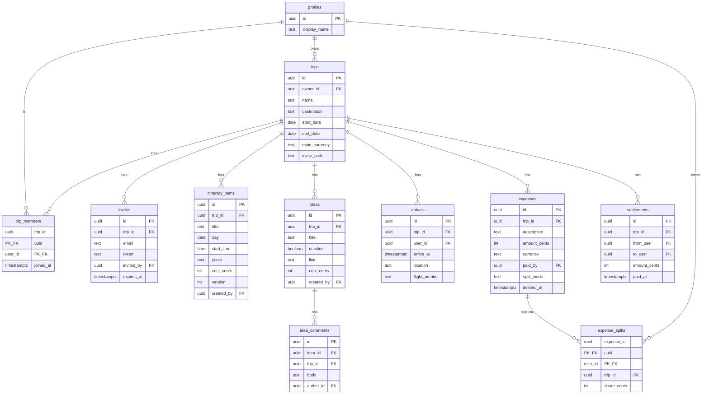

# Database Diagram

This shows the Group Travel App's tables and how they connect. GitHub renders the
Mermaid diagram below as a picture. See [database-design.md](database-design.md)
for the full column-by-column description.

Notes:
- Every table has Row-Level Security on, scoped to trip members through `trip_id`.
- `profiles.id` matches the Supabase Auth user id.
- Money is always stored as whole cents plus a currency code (no floating-point money).
