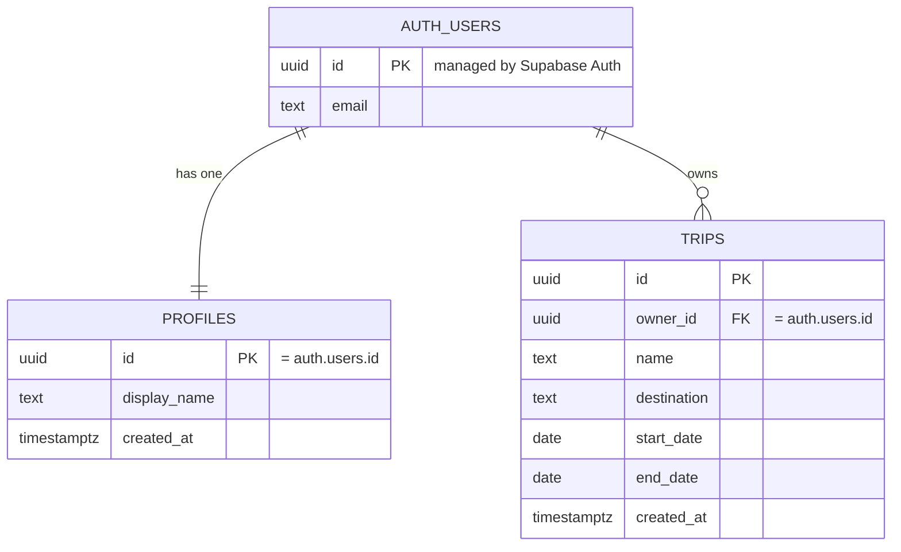

# Database Diagram — Group Travel App

This diagram shows the database tables and how they relate. Money and dates are
kept simple for MVP #1. Security (Row Level Security) ensures each person only
sees their own `trips`.

## In plain words
- **auth.users** — the built-in Supabase login table (one row per account).
- **profiles** — one profile per user, created automatically at sign-up.
- **trips** — each trip belongs to the user who created it (`owner_id`). One user
  can own many trips.
